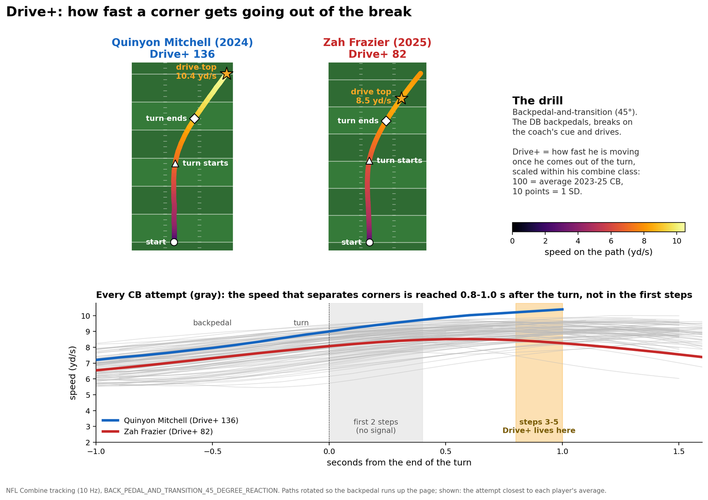
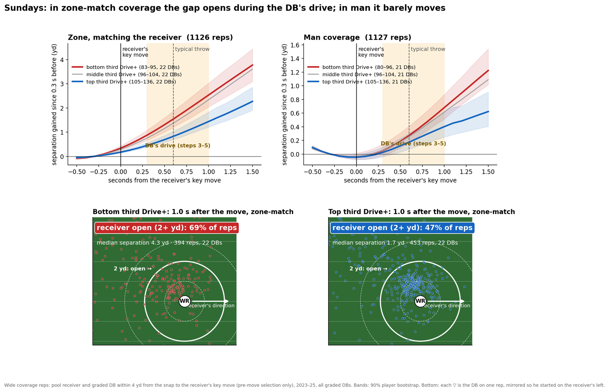
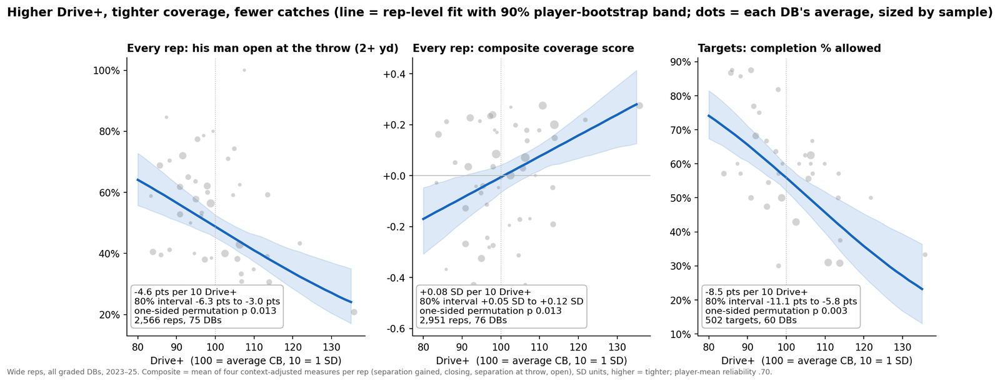
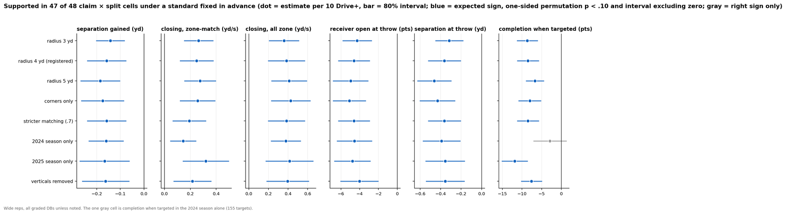
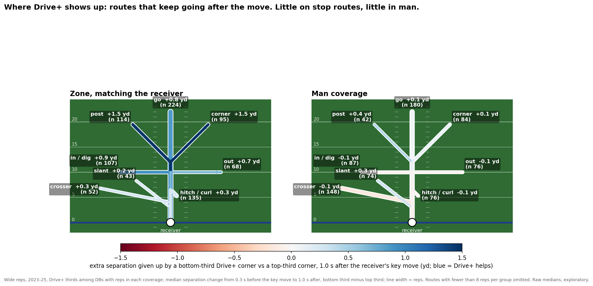
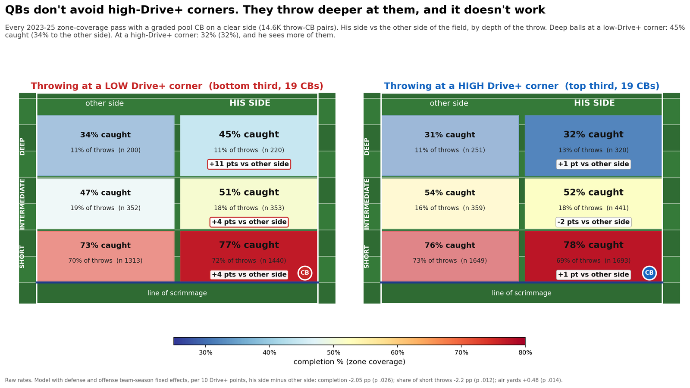
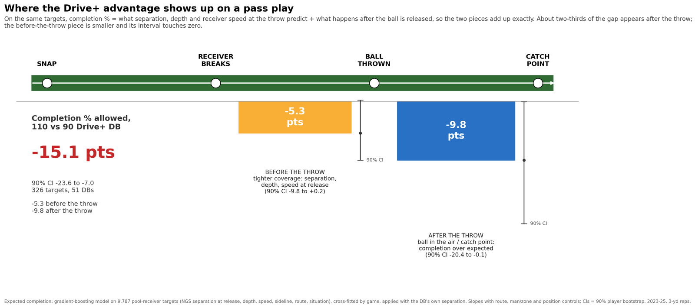
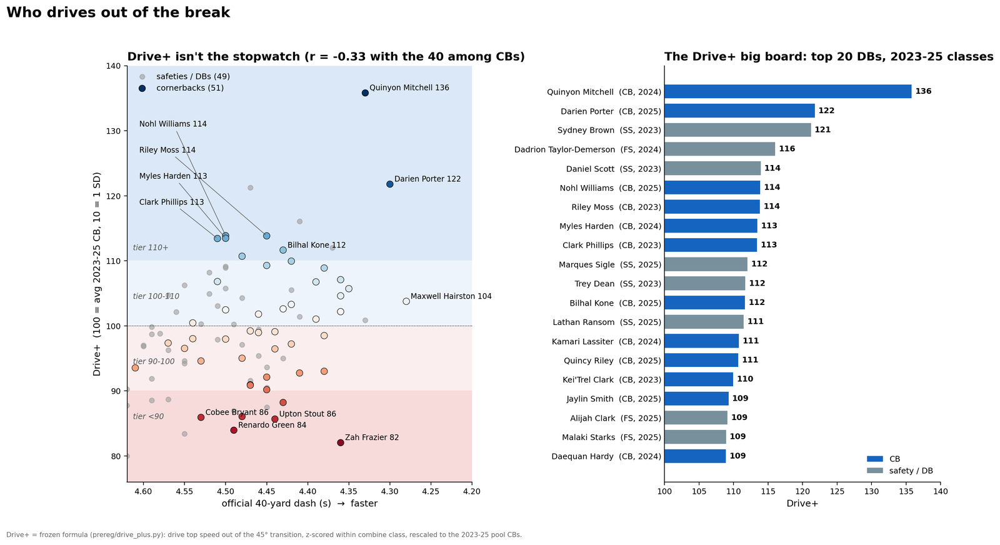

# Drive+: the combine drill that tells you who can run with a receiver in zone

## The question

Corners are drafted on the 40, the three-cone and the eye test, then asked to do something none of those measure: turn out of a backpedal and run with a receiver who has already made his move. We asked whether the combine's own tracking captures that skill and whether it shows up in NFL coverage. It does, in one drill, in one second of it, and mostly in one coverage family. We call the result **Drive+**.

Everything below uses only the competition data: 10 Hz combine tracking for the 2023–25 classes and 2023–25 game tracking for the 510 tracked players.

## What Drive+ measures

The drill is the combine's backpedal-and-transition. A defensive back holds a backpedal for about 15 yards; on the coach's cue he opens his hips, turns roughly 40 degrees and sprints away on the new line. No ball is involved; it is a pure turn-and-run.

Drive+ is **how fast he is running once he has made that turn**. From the 10 Hz positions we compute speed and heading. The turn begins when his heading swings more than 10 degrees off the backpedal line and ends when it reaches 90 percent of its peak swing; from that moment we take the **highest speed he reaches in the drive that follows**, in yards per second, and average his attempts (usually two). Corners reach that peak 0.8–1.0 seconds after the turn, 9–10 yards into the drive, about steps three to five. Drive+ is therefore a re-acceleration number: how much speed he can build after turning, not how much he kept through the turn and not how quickly his first step came. We measured those too, and they either do not repeat between a player's attempts or do not predict anything (Figure 1).

Raw values run from 8.5 to 10.4 yd/s among corners. Because clip lengths and setups differed by year, each player is z-scored against everyone who ran the drill at his own combine, and that z is rescaled so the 2023–25 corners average 100 with a standard deviation of 10. Quinyon Mitchell's 10.4 yd/s becomes 136; a 9.2 yd/s corner sits near 100; 8.7 near 90. The rule is fixed and contains no NFL information.

Drive+ is not the stopwatch: it correlates −0.33 with the 40 among corners, and the leaders include 4.50 runners graded 113–114 and 4.36 runners at 107 (Figure 9, appendix). It repeats across a player's two attempts at reliability 0.66, which is modest; we return to that.

## Sundays: a zone-match trait

We built coverage reps from every dropback on which a tracked receiver ran a route and a graded defensive back was within 4 yards of him from the snap to the receiver's key move, his sharpest change of direction. Selecting on proximity *before* the move matters: a rep definition that uses the whole route quietly drops the plays where the corner got beaten. That gives 2,952 reps, 76 defensive backs and 502 targets. Every rep is tagged by coverage call and by whether the DB was already running with the receiver before the move (velocity alignment ≥ 0.5), which separates **zone-match** reps from man and from spot-drop zone.

Figure 2 shows the separation clock. In zone-match reps, the receiver's key move opens space against every corner, but against top-third Drive+ corners it opens about half as much by one second, exactly the window of the DB's own drive. In man coverage the thirds barely separate. The lower panels show where the DB is one second after the move: against bottom-third corners the receiver is open (2+ yards) on 69% of reps, against top-third corners on 47%.

Figure 3 puts one play on each side. Each is the rep closest to its group's typical separation on a corner route in zone-match coverage. Kei'Trel Clark (Drive+ 110) is inside a yard of Chimere Dike through the break and 1.3 yards out of it; Cameron Mitchell (91) is trailing Quentin Johnston by two yards when the ball arrives. Neither is a highlight; the grade describes the ordinary rep.

## How much, and how sure

Three outcomes carry the claim (Figure 4). Per 10 Drive+ points, with the receiver's own separation skill, route, coverage and position held fixed:

- his receiver is open at the throw **4.6 points less often** (80% interval 3.0–6.3);
- a **composite coverage score**, the mean of four context-adjusted measures per rep, rises **0.08 SD** (0.05–0.12). The composite is the registered criterion because its player-mean reliability (0.70) beats any single measure;
- when his receiver is targeted, completions fall **8.5 points** (5.8–11.1). A 110 corner against a 90 corner is 17 points of completion percentage.

All p-values are one-sided, from shuffling grades across players, so no single corner can manufacture a result. Across players, Drive+ correlates 0.29 with the composite as measured and about 0.42 once the noise in both sides is accounted for.

Because the data are thin, about 50 corners and 500 targets, we fixed the evidence standard in advance and applied it to everything, nulls included: expected sign, one-sided permutation p < .10, and an 80% interval excluding zero. Figure 5 runs six claims through eight splits: rep radius 3, 4 and 5 yards; corners only; a stricter matching threshold; each season alone; and verticals removed, because on a go route the "key move" is only the receiver's stem adjustment. **Forty-seven of 48 cells are supported.** The exception is completion in the 2024 season alone, which has the right sign but a wide interval; the completion effect is concentrated in 2025, while the movement measures agree across seasons.

Two things it does not do. It does not grade safeties: at safety the drill shows no link to coverage; only when safeties line up at corner does the sign match. And it does not grade man coverage: the composite slope in man-match reps is +0.02 SD and not supported. That is the point. The drill asks for a turn-and-run, and the reps where that is the job are the reps where the grade works.

Figure 6 draws that by route. In zone-match coverage the bottom-third corner gives up 0.7–1.5 extra yards on routes that keep going after the move, posts, corners, go routes, digs and outs, and about nothing on hitches and slants; in man the differences vanish. These are raw medians on modest samples, so read the tree as a map of where to look rather than a claim per route.

## The quarterback's answer

If high-Drive+ corners are tighter, quarterbacks should respond. We looked at every zone pass with a graded corner lined up on a clear side of the field, 14,636 throws, and compared throws to his side with throws to the other side, inside the same defense and season. The other side is a built-in placebo: the corner is not involved there.

Quarterbacks do not avoid him; 52% of throws still go to his side regardless of grade. They **throw deeper at him**: air yards rise about half a yard per 10 Drive+ points relative to the other side, and the share of short throws falls. It does not pay (Figure 7). Completions to his side fall 2 points per 10 Drive+ relative to the other side; deep balls at a bottom-third corner are caught 45% of the time against 34% to the far side, while at a top-third corner the two sides are identical at 32%. EPA on his side does not move, because the throws that fail are the deep ones that would have paid most.

## What we could not explain, said plainly

On targets of his own receiver, we split the completion gap into the part predicted by separation, depth and speed at the release and the part that happens after the ball is in the air (Figure 8). About a third of the gap is the first; two-thirds is the second. We could not find the mechanism for the after-throw share. Breakups credited in the play-by-play do not rise with Drive+, body orientation at the catch point does not differ, and the share is heavier in 2025. We therefore register it as a separate hypothesis and judge the movement claims without it. The grade stands on the pre-throw evidence; the after-throw edge is a bonus until 2026 says otherwise.

Other honest limits. The receivers in these reps are all tracked-pool players, so they are young receivers. Only the 45-degree drill carries the signal: the 90-degree break-to-ball drill and the other DB drills do not measure the same thing (r 0.06–0.28 with Drive+), and every attempt to improve the formula ranked players the same or predicted worse out of sample. Drive+ was found by an exploratory screen, so the permutation p-values do not account for the search. For that reason the metric, the rep definition, the composite, the evidence standard and the hypotheses are frozen in a dated pre-registration whose hashes are in the appendix, before any 2026 data exists. The 2026 class will run the drill in February; the test is already written.

## What a team would do with it

1. **Scout it for the scheme.** Drive+ is a turn-and-run grade. Cover 3 and quarters-match teams, where the corner carries vertical and in-breaking routes after the receiver declares, should weight it; heavy-man teams should not.
2. **Read the drill, not the clock.** A corner who looks explosive in his first two steps but tops out early is not the one you want running with a post.
3. **Measure it twice more.** One attempt repeats at 0.49; two give 0.66; four would give about 0.80. Two extra reps of this drill at a pro day are the cheapest reliability a team can buy, and the recording needs to run at least 1.5 seconds past the turn, which the 2024 combine clips did not.
4. **Expect quarterbacks to adjust.** The grade predicts fewer completions and deeper throws, not more interceptions or a lower EPA on his side. Pair it with ball skills from film.

Drive+ is one number from one second of one drill. That is also why it survived every check we could throw at it: it measures one thing, the thing the job asks for.

---

### Appendix

**Figure 9.** Drive+ against the official 40 for every graded DB, and the top 20.

**Definitions.** Drive+ = 100 + 10 × (z − 0.0794) / 1.0405, where z is the player's mean drive top speed (yd/s) in the 45-degree transition drill, z-scored within his combine class. Turn detection: Savitzky–Golay (window 7, order 2) velocities; backpedal line = median heading of the first four frames at ≥ 2 yd/s; turn start = first frame at ≥ 3 yd/s deviating > 10°, with a 25–90° peak deviation within 1.5 s; turn end = 90% of that peak; drive top = running maximum from the turn end for up to 2 s, stopping 0.5 yd/s below the maximum. Coverage rep: pool receiver and graded DB, mean distance ≤ 4 yd from 0.5 s after the snap to the receiver's key move (peak smoothed lateral acceleration at > 2 yd/s, 0.5–3 s), ≥ 4 pre-move frames. Zone-match: zone call and pre-move velocity cosine ≥ 0.5. Composite: mean of per-rep z-scores of separation gained (−), closing over 0.7 s (+), separation at the throw (−) and open at the throw (−), each residualized on receiver skill, zone/man, route and position. Inference: OLS with the controls named, SEs clustered by DB, one-sided player-permutation p (grades shuffled across players), 80% intervals.

**Pre-registration (frozen 2026-10-12/13, before any 2026 data).** `drive_plus.py` SHA-256 `f1a2847b248efce018aaeb884cf0e8ffdde2aadee2dcb098b48a2ced66f55bc6`; addenda d–f register the primary tests (zone-match closing; throw-side completion), the wide sample, the composite criterion, the evidence tiers and the separate after-throw hypothesis.

**Code.** The attached notebook reproduces every figure and number from the competition files; the full analysis repository is linked there.
